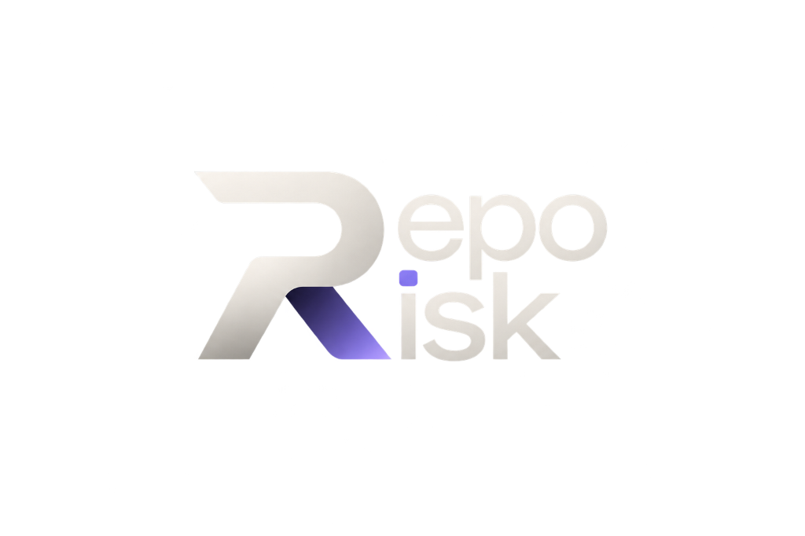

<p align="center">
  
</p>

<p align="center">
  <strong>Know what can go wrong before your code does.</strong>
</p>

<p align="center">
  <a href="https://github.com/shrishskulkarni/reporisk/actions"></a>
  <a href="LICENSE"></a>
  <a href="https://nodejs.org"></a>
  <a href="https://pnpm.io"></a>
</p>

---

> **Core Directive:**  
> *Paste any repository. RepoRisk builds a complete map of what can go wrong, proves what it can, explains what it can't prove, and tells you what to fix first.*

RepoRisk is a **Repository Risk Intelligence Platform**. It moves beyond traditional siloed vulnerability scanners by correlating application code, secrets, software supply chain, CI/CD pipelines, and architectural reliability into a single explainable risk graph.

---

## Why RepoRisk?

Existing tools excel at narrow, single-domain detection (e.g., Gitleaks finds secrets, OSV finds CVEs, Semgrep matches syntax, Checkov audits infrastructure). However, development teams are left with disconnected alert dumps and no actionable understanding of:
1. **Reachability:** Can an external attacker reach the vulnerable dependency through public routes?
2. **Exploitation Chains:** Does a leaked credential grant access to the deployment bucket referenced in a CI workflow?
3. **Failure Paths:** Will an unhedged external dependency trigger thread pool exhaustion during an outage?
4. **Remediation Priority:** Which single fix eliminates the greatest marginal risk across all attack paths?

RepoRisk bridges this gap by transforming raw multi-scanner findings into a unified, evidence-backed risk model.

---

## Core Product Principles

### 1. The Tri-Factor Independence Invariant
Every finding strictly separates three orthogonal dimensions:
$$\text{Severity (Impact)} \neq \text{Confidence (Certainty)} \neq \text{Validation Status (Provenance)}$$
- **Severity:** The magnitude of potential harm if exploited.
- **Confidence:** The likelihood that the static finding is technically accurate.
- **Validation Status:** How the finding was verified (`DETERMINISTICALLY_CONFIRMED`, `HEURISTICALLY_INFERRED`, `UNVALIDATED`, `FALSE_POSITIVE`).

### 2. Edge-Level Evidence Standards
A speculative exploit chain is never presented as a proven attack path. In RepoRisk, evidence is attached directly to graph edges:
- **`CONFIRMED`:** Proven via deterministic static call-graphs, manifest links, or exact string references.
- **`INFERRED`:** Topologically plausible based on dependency and route structure.
- **`HYPOTHETICAL`:** Contextual possibility, explicitly marked as speculative.

The path classification is governed by the weakest link: $\min(\text{edges})$.

### 3. Explainable Risk Engine (No False Precision)
- Risk scores are integers ($0 - 100$). Complex mathematics are never used to mask heuristic uncertainty.
- Every score embeds full mathematical derivation and parameter manifests (`model_version: "1.0.0-heuristic"`).
- Fixes are ranked by **Marginal Risk Reduction ($\Delta R$)** per unit effort:
  $$\Delta R(k) = R_{\text{repo}} - R_{\text{repo} \setminus \{k\}}$$

### 4. Non-Negotiable Execution Security
RepoRisk treats the repository under analysis as **untrusted and potentially hostile**:
- **Category A (Approved Scanners):** Allowlisted tools (Gitleaks, Semgrep, OSV, Checkov) run strictly in sandboxed subprocesses with memory caps, 120s wall-clock timeouts, and direct argument vectors (`execFile`). Shell interpolation is forbidden.
- **Category B (Target Repository Code):** Target repository scripts (`postinstall`, `setup.py`, Makefiles, test suites) are **NEVER EXECUTED**.

---

## System Architecture

RepoRisk is built as a **Typed Modular Monolith** in TypeScript on Node.js:

```text
┌────────────────────────────────────────────────────────────────────────────────────────┐
│                               REPORISK CORE MONOLITH                                   │
│                                                                                        │
│   ┌────────────────────┐    ┌────────────────────┐    ┌────────────────────┐          │
│   │  Ingestion Engine  │───▶│ Topology Discovery │───▶│Scanner Orchestrator│          │
│   │(URL/Sandbox/Clone) │    │(Entrypoints/Trust) │    │ (Category A Tools) │          │
│   └────────────────────┘    └────────────────────┘    └─────────┬──────────┘          │
│                                                                 │                     │
│                                                                 ▼                     │
│   ┌────────────────────┐    ┌────────────────────┐    ┌────────────────────┐          │
│   │ Remediation Engine │◀───│    Risk Engine     │◀───│Correlation Engine  │          │
│   │("Fix First" Rank)  │    │(Versioned Scoring) │    │(Attack/Fail Paths) │          │
│   └─────────┬──────────┘    └────────────────────┘    └─────────▲──────────┘          │
│             │                                                   │                     │
│             ▼                                         ┌─────────┴──────────┐          │
│   ┌────────────────────┐                              │Normalizer & Dedupe │          │
│   │ Report Serializer  │                              │(13-Field Schema)   │          │
│   │(Markdown/JSON/SARIF│                              └────────────────────┘          │
│   └────────────────────┘                                                              │
└────────────────────────────────────────────────────────────────────────────────────────┘
```

- **`@reporisk/core`:** Pure business logic, typed contracts, scanning orchestration, correlation graphs, and risk calculation.
- **`reporisk` (`packages/cli`):** Command-line interface providing interactive progress, ANSI summaries, and export capabilities.

---

## Quickstart

### Prerequisites
- Node.js $\ge 20.0.0$
- pnpm $\ge 9.0.0$
- Git

### Installation & Build

```bash
# Clone the repository
git clone https://github.com/shrishskulkarni/reporisk.git
cd reporisk

# Install workspace dependencies
pnpm install

# Build all packages
pnpm run build

# Run unit and integration tests
pnpm test
```

### Verifying Tool Readiness

Check which local security scanners are available on your system:

```bash
pnpm --filter reporisk exec reporisk doctor
```

### Running an Analysis

```bash
# Scan a local repository
pnpm --filter reporisk exec reporisk scan /path/to/target-repo

# Scan a public GitHub repository
pnpm --filter reporisk exec reporisk scan https://github.com/owner/repo
```

---

## Repository Documentation

- [Product Specification](docs/product/PRODUCT_SPECIFICATION.md): Feature matrix, 13-field schema, and phased boundaries.
- [System Architecture](docs/architecture/ARCHITECTURE.md): Subsystems, data flow, and technology decisions.
- [Risk Model](docs/architecture/RISK_MODEL.md): 5-domain risk calculations and graph correlation mathematics.
- [Threat Model](docs/security/THREAT_MODEL.md): STRIDE matrix, sandbox parameters, and untrusted code defenses.
- [Contributing Guide](CONTRIBUTING.md): Development workflow and dual-approval governance.
- [Security Policy](SECURITY.md): Vulnerability reporting and responsible disclosure.
- [Roadmap](ROADMAP.md): Tier 1 through Tier 3 delivery milestones.

---

## Governance & Maintenance

- **Owner & Principal Maintainer:** Shrish Kulkarni ([@shrishskulkarni](https://github.com/shrishskulkarni))
- **License:** [Apache License 2.0 with RepoRisk Non-Commercial and Patent Reservation Rider](LICENSE) (Explicit written permission from Shrish Kulkarni required for commercial or patent use)
